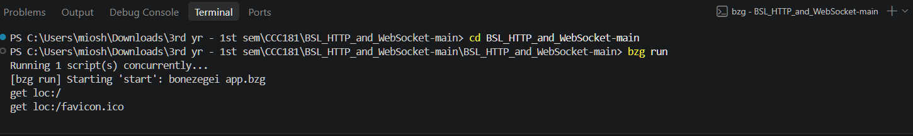
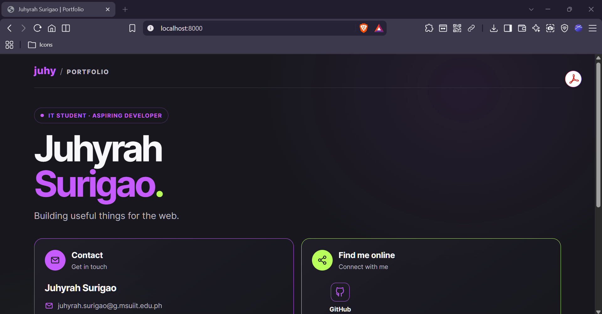
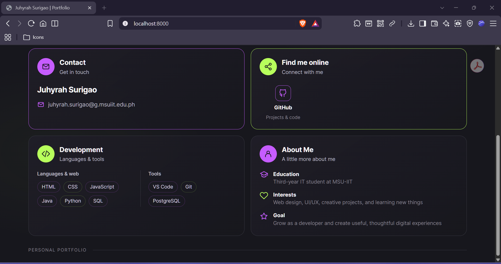

# Personal Portfolio Landing Page

## Project Description

This project is a personal portfolio landing page created using Bonezegei Scripting Language (BSL). It presents my introduction, contact information, social links, and development-related information through a simple and visually styled web interface.

## Setup and Execution Steps

1. Install the required BSL tools and dependencies.
2. Clone or download this repository.
3. Open a terminal in the project directory containing `package.json`.
4. Install the dependencies:

   ```bash
   bzg install
   ```

5. Run the application:

   ```bash
   bzg run
   ```

6. Open `http://localhost:8000` in a web browser to view the portfolio.

## Execution Verification

The screenshots below demonstrate the successful execution of the application.

### Terminal Execution



### Portfolio in Browser




